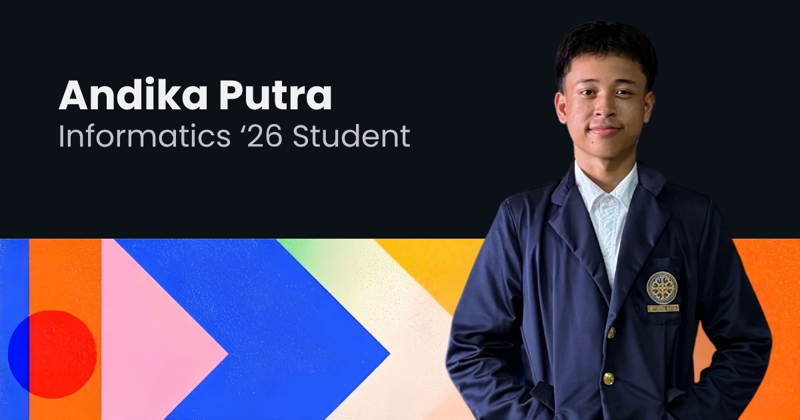

Informatics student at Udayana University &nbsp;&middot;&nbsp; currently working on OpenPOS for Indonesian SMEs

## About Me

I'm **Andika**, an Informatics student at **Udayana University** building web applications end to end, from frontend interfaces to backend systems and databases.

- Currently building **[OpenPOS](https://github.com/0xMinomus/openPOS)**, a Point of Sale system for Indonesian SMEs, now at integrated MVP stage
- Working across frontend, backend, databases, APIs, and deployment to understand the full development lifecycle
- Using AI-assisted tools to accelerate development while ensuring full code comprehension before shipping
- Focused on becoming a full-stack developer with a solid grasp of both application development and the systems behind it

## Tech Stack

             

## Featured Projects

<table align="center">
  <tr>
    <td width="50%" style="background:#0a0a0a;border-radius:14px;padding:20px;">
      
// PROJECT 01

      
<a href="https://github.com/0xMinomus/openPOS" style="color:#ffffff;">OpenPOS</a>

      
Point of Sale for Indonesian SMEs. Covers authentication, cashier POS, product and inventory management, transactions and refunds, reports, user management, and role-based access, all connected to a Go backend. Frontend and backend are fully integrated at MVP stage.

      
React &middot; TypeScript &middot; Go/chi &middot; PostgreSQL &middot; JWT

    </td>
    <td width="50%" style="background:#0a0a0a;border-radius:14px;padding:20px;">
      
// PROJECT 02

      
<a href="https://github.com/0xMinomus/OhMyFlow" style="color:#ffffff;">OhMyFlow</a>

      
An offline AI photo culler for Windows. It sorts thousands of photos into Picks, Maybe, and Rejects in minutes, then exports the ratings as XMP straight into Lightroom. Everything runs on your own machine, no cloud, no subscription.

      
Electron &middot; React &middot; TypeScript &middot; ONNX &middot; Tailwind

    </td>
  </tr>
  <tr>
    <td width="50%" style="background:#0a0a0a;border-radius:14px;padding:20px;">
      
// PROJECT 03

      
<a href="https://github.com/0xMinomus/CCode" style="color:#ffffff;">CCode</a>

      
A no-account, local-first fork of ZCode for agentic coding and desktop automation. Keeps all tasks, keys, and session data strictly on your machine without cloud dependency, featuring desktop automation via MCP on Linux and Windows.

      
Electron &middot; TypeScript &middot; Node.js &middot; Python &middot; MCP

    </td>
    <td width="50%" style="background:#0a0a0a;border-radius:14px;padding:20px;">
      
// PROJECT 04

      
<a href="https://github.com/0xMinomus/n8n-vision-grader" style="color:#ffffff;">n8n-vision-grader</a>

      
Automated student assignment grading workflow built on n8n. Ingests submissions from Google Drive, renders multi-page PDFs through a Docker sidecar, evaluates answers with a vision LLM, and logs scores and rationales to Google Sheets.

      
n8n &middot; Docker &middot; Python &middot; Vision LLM &middot; Google APIs

    </td>
  </tr>
  <tr>
    <td width="50%" style="background:#0a0a0a;border-radius:14px;padding:20px;">
      
// PROJECT 05

      
<a href="https://github.com/0xMinomus/tractus-manus" style="color:#ffffff;">Tractus Manus</a>

      
A local, webcam-driven mouse for Windows. MediaPipe tracks 21 hand landmarks per frame, so you point to move the cursor, pinch to click or drag, scroll with two fingers, and hold a fist to pause. Camera frames never leave memory, and an optional classifier can be trained on your own landmarks.

      
Python &middot; MediaPipe &middot; OpenCV &middot; NumPy &middot; Windows SendInput

    </td>
    <td width="50%" style="background:#0a0a0a;border-radius:14px;padding:20px;">
      
// PROJECT 06

      
<a href="https://github.com/0xMinomus/tweakbon" style="color:#ffffff;">Tweakbon</a>

      
A browser-only twibbon editor. Drop a frame and your photo or video, pan and zoom it into the template's transparent hole, then export a PNG or MP4. Everything is composited and encoded inside the tab, with no server, no database, no account, and no upload.

      
React &middot; TypeScript &middot; Vite &middot; Canvas &middot; MediaRecorder

    </td>
  </tr>
</table>

## GitHub Stats

  <picture>
    <source media="(prefers-color-scheme: dark)" srcset="https://raw.githubusercontent.com/0xMinomus/0xminomus/output/pacman-contribution-graph-dark.svg">
    <source media="(prefers-color-scheme: light)" srcset="https://raw.githubusercontent.com/0xMinomus/0xminomus/output/pacman-contribution-graph.svg">
    
  </picture>

<table align="center">
  <tr>
    <td align="center"></td>
    <td align="center"></td>
  </tr>
</table>

  

> *"I don't just want to build apps, I want to understand the systems behind them."*

## Connect With Me

  

    <a href="https://andika-portofolio-eta.vercel.app/" style="color:#ffffff;">portfolio</a>
    &nbsp;&middot;&nbsp;
    <a href="https://github.com/0xMinomus" style="color:#ffffff;">github</a>
    &nbsp;&middot;&nbsp; always open to discussing projects and ideas
  

  &copy; 2026 Andika Putra. Built with curiosity, one commit at a time.

